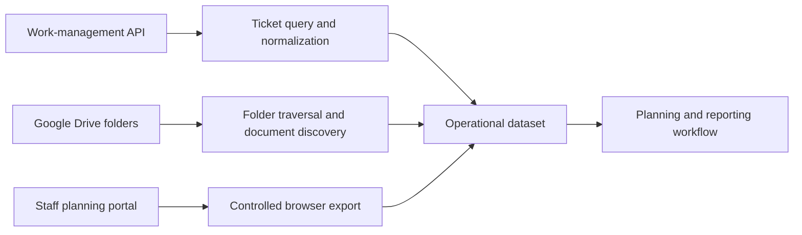

# Operations Document Automation

A Python automation suite that connects work-management data, cloud file storage, and staff-planning documents to reduce repetitive operational reporting work.

## Problem solved

Teams often assemble planning reports by manually checking work tickets, navigating nested cloud folders, locating the correct spreadsheet, and downloading staff-planning files. This solution automates discovery and collection while keeping source systems independently configurable.

## Architecture

## Technology

Python · REST APIs · Google Drive API · OAuth 2.0 · Selenium · requests · Environment-based configuration

## Engineering highlights

- Queries current and recent work items through reusable API helpers.
- Traverses nested Drive structures and locates matching planning files.
- Supports authorized browser export for staff-planning documents.
- Separates OAuth client files, tokens, portal credentials, and folder identifiers from code.
- Keeps extraction responsibilities modular for independent maintenance.

## Documentation

- [Architecture](docs/architecture.md)
- [Integration boundaries](docs/integrations.md)
- [Security](docs/security.md)

> Client documents, downloaded files, videos, OAuth tokens, and production credentials are excluded from this public showcase.
