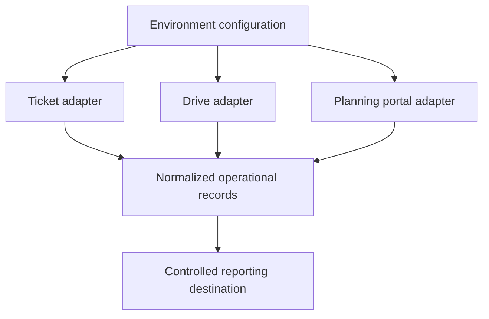

# Architecture

The automation separates three adapters from one reporting boundary:

Each adapter owns authentication, retrieval, and source-specific normalization. The reporting layer receives standardized records and file references rather than source-specific response structures.
